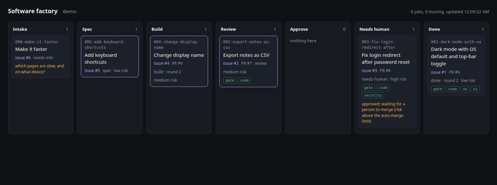

# Claude-Factory_software-engineering-pipeline

A software factory for Claude Code. You label a GitHub issue `factory`, type `/factory run`,
and the issue moves through intake, specification, build, automated checks, review and
approval to a merged pull request, with a person brought in only where the rules say so.



## The pipeline

```
GitHub issue (label: factory)
      |
   Intake ............ worth building? how risky? what does it touch?
      |                  needs-info: asks the author      reject: says why
   Spec writer ....... a short, testable specification
      |
   Builder ........... one git worktree, one branch, one pull request   <-----+
      |                                                                      |
   Gate .............. factory/checks.sh; a failure goes back with the log --+
      |                                                                      |
   Reviewers ......... routed by risk; any "changes" goes back --------------+
      |                  code review        always (a stronger model if high risk)
      |                  UX and UI review   when the change touches the interface
      |                  security review    high risk, or touches security, data, infra
   Approver .......... approve, ask for changes, or escalate
      |
   Merge ............. automatic up to a risk limit you set; otherwise a person merges
```

Up to three jobs run at once, each in its own worktree. A job that fails the gate or a
review three times stops and waits for a person.

## What makes it safe to leave running

- **The orchestrator decides nothing.** Every rule (stage order, which reviews are required,
  round limits, when to merge) is in `factory/bin/job`, a script of about 450 lines, with tests. The
  `/factory` command asks it what to do next and does that.
- **The gate cannot be weakened by the builder.** Checks run from the main checkout's copy
  of `factory/checks.sh`, not the copy on the job's branch.
- **Reviewers cannot edit code**, and every review is redone after a change.
- **High-risk changes never merge on their own.** Intake marks authentication, payments,
  personal data, migrations and infrastructure as high risk; those always stop for a person.
- **Only a person can release a parked job.** `factory/bin/job release` refuses to run
  without a terminal and asks you to type the issue number, so an agent cannot approve its
  own escalation.
- **Only the reviewed commit is merged.** The merge checks that the pull request is the
  job's own branch and still at the commit that passed the gate and review. If it moved,
  the job stops for a person.
- **The board answers only requests addressed to this machine.**
- **No permission bypass is needed.** `factory/settings.example.json` allows the specific
  commands the factory uses and denies force-pushes and direct merges.
- **Issue text is treated as a request, not as instructions.** Intake and the reviewers are
  told to reject or report text that tries to steer them.

## Install it in a repository

You need [Claude Code](https://claude.com/claude-code), the GitHub CLI (`gh`, logged in),
git and Python 3.11 or newer.

```bash
git clone https://github.com/AmosBunde/Claude-Factory_software-engineering-pipeline
./Claude-Factory_software-engineering-pipeline/install.sh /path/to/your/repo
```

The installer copies files and never overwrites one that already exists. Then, in your repository:

1. **Describe the project** in `factory/FACTORY.md`: what it is, how to run it, the
   conventions that matter. Every agent reads this.
2. **Make the gate real.** Run `bash factory/checks.sh` on a branch with a change. It
   detects npm, Python, Go and Rust projects; edit it until it runs your tests and linters.
3. **Allow the factory's commands** by merging `factory/settings.example.json` into
   `.claude/settings.json`. Skip this and Claude Code will ask before each command.
4. **Create the label:** `gh label create factory --description "Build this with the software factory"`
5. **Commit** `factory/` and `.claude/`.

## Use it

```bash
gh issue create --label factory --title "Dark mode" --body "Add a dark theme with a toggle in the top bar."
factory/bin/dashboard          # optional: the board at http://127.0.0.1:8765
```

Then, in Claude Code:

| Command | What it does |
|---|---|
| `/factory run` | Picks up new labelled issues and moves every job as far as it can go |
| `/factory status` | Reports new issues, active jobs and anything waiting for you; starts nothing |
| `/factory resume <job-id>` | Continues a job after you answered a question or released it |
| `/factory stop` | Starts no new agents and reports where each job stands |

When a job stops for you, the board and `/factory status` say why. Typical cases: intake
needs an answer on the issue, a change is high risk and approved but waiting for you to
merge, or three rounds were not enough. You release it yourself, in a terminal:

```bash
factory/bin/job release 003-fix-login-redirect merge      # or: build, rejected
```

## Settings

`factory/config.json`:

| Setting | Default | Meaning |
|---|---|---|
| `label` | `factory` | Issues with this label enter the factory |
| `max_parallel_jobs` | 3 | Jobs moving at once |
| `max_build_rounds` | 3 | Failed gates or change requests before a person decides |
| `auto_merge` | true | Set to false to have a person merge everything |
| `auto_merge_max_risk` | `medium` | Jobs above this risk always wait for a person |
| `merge_method` | `squash` | Passed to `gh pr merge` |
| `models` | see file | The model for each stage |

The default models follow the cost of a mistake at each stage: a strong model for intake,
the spec, the build, security review and approval; cheaper ones for routine code and
interface review. Change them to fit your budget.

## What is in this repository

| Path | What it is |
|---|---|
| `kit/.claude/skills/factory/SKILL.md` | The `/factory` command: the orchestrator's instructions |
| `kit/.claude/agents/` | Eight agents: intake, spec writer, builder, four reviewers, approver |
| `kit/factory/bin/job` | Job state and every rule; `job next <id>` says what happens next |
| `kit/factory/checks.sh` | The gate |
| `kit/factory/bin/dashboard`, `kit/factory/dashboard/` | The local, read-only board |
| `kit/factory/FACTORY.md`, `config.json`, `settings.example.json` | Project rules, settings, permissions |
| `install.sh` | Copies the kit into a repository |
| `tests/` | 32 tests of the rules, the gate, the installer, the agent files and the board |

Run the tests with `uv run pytest -q`. They replace `gh` with a local stand-in and use no network.

## Limits, stated plainly

- **The rules are tested; a full live run is not included here.** The tests drive the state
  machine through every path with a stand-in for GitHub. A real `/factory run` also depends
  on how well each agent does its job on your codebase. Start with `auto_merge` set to
  false and a few small issues, and read the first pull requests yourself.
- **It costs tokens.** One issue runs five to eight agents, more if it goes back for changes.
- **Agents make mistakes.** Review by other agents catches many of them and not all. The
  gate is only as good as your tests.
- **One repository, one machine.** Job state is local files under `factory/jobs/` (not
  committed). Two people running the factory on the same repository at once is not handled.
- **GitHub only.**

## Licence

MIT. See [LICENSE](LICENSE).
